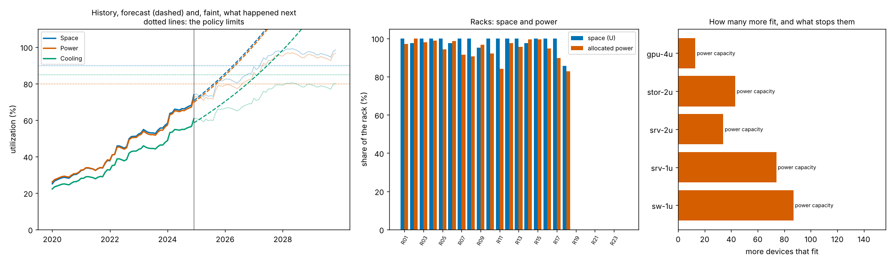

# dccap: when does a data center run out of space, power or cooling, checked two ways

[](https://github.com/TexAlphaWolf/dc-capacity-planner/actions/workflows/ci.yml)
[](https://github.com/TexAlphaWolf/dc-capacity-planner/actions/workflows/codeql.yml)


A capacity planner for a server room or data center. From a **facility** (racks, UPS and cooling plants) and an **inventory**
(every device, with its rack, position, power and the months it was installed and removed) it reports how much **space, power and
cooling** is used, **which one runs out first and when** (with an interval), how many more standard devices **actually fit**
(rack by rack, first fit), and how much capacity is **stranded**. A what-if command places new devices or keeps adding some every
month until something stops it. The analysis is vectorised, and a second implementation that **works one device at a time in plain
Python** checks it. A forecast has no answer key in real life, so the project also ships a **synthetic data center that knows
what happens next**, and scores the forecasts against it. A command line (`dccap`) with tests, a Docker image and reports
generated from the numbers.



## What the numbers say

The demo data center ([`docs/report.json`](docs/report.json)) is 24 racks and 1,008 U, simulated for 60 months, with 557 devices
installed at the end. **It is synthetic and illustrative**, not a real facility; the point is what the analysis does with a data
center whose future is known. Speed figures are from one run in Docker on Linux x86_64 with 12 CPUs, Python 3.14.10 and NumPy 2.5.4
([`docs/bench.json`](docs/bench.json); medians of 5 runs).

1. **Power runs out first, in about 9 months.** As of 2024-12 the space is 73.9% used (limit 90%), the power 72.6% allocated (limit
   80%) and the cooling 60.8% (limit 85%). Power is forecast to reach its limit in 2025-10, with a 90% interval of 1 to 18 months.
2. **Allocated is not drawn.** Power is allocated at 80% of the nameplate: 204.2 kW. The devices draw 131.3 kW, so the power
   allocated is 1.56 times what is drawn. The racks could pull 288 kW between them, 1.02 times the usable power of the UPS.
3. **Free space is not usable space.** Of the 1,008 U, 3 free units sit in racks with too little power left for even the smallest
   device, and 9.1 kW of rack power is left in racks that have no free unit. The 6 empty racks do not help: what stops the next
   device is the power capacity, for every model.
4. **How many more fit**, one model at a time: 87 sw-1u, 74 srv-1u, 34 srv-2u, 43 stor-2u, 13 gpu-4u, all stopped by the power
   capacity.
5. **On this demo the forecast is too early.** The truth says power really reached its limit after 21 months (forecast 9.3, outside
   the interval) and space after 28 (forecast 16.4, inside). The cooling is forecast at 26.6 months and never reaches its limit in the
   72 simulated months. A data center that slows down after its recent growth is the case a trend cannot see.
6. **Across 50 synthetic data centers, analysed at 4 dates each**, 505 forecasts could be checked. 351 give a month for a crossing
   that happens: the median error is 9.6 months (95th percentile 39.7), and the true month is inside the 90% interval 76.9% of the
   time. **The interval is honest only for the near term**: 87.5% when the limit is 1 to 12 months away, 85.4% at 13 to 24, 75.0% at 25
   to 48 and 44.7% beyond that. Power and cooling are 84.7% and 84.3%; space is 59.4%.
7. **126 of the 505 forecasts announce a crossing that does not happen** (61 of them within 24 months) and 14 miss one. A trend
   does not know that devices are retired and that growth stops where the racks cannot take more.
8. **Two implementations, one answer.** The NumPy analysis and the plain Python one agree to 8.20e-14 (relative) on 51 comparisons
   and 12,714 numbers, on a simulated facility and on random facilities with random policy.
9. **Speed.** 999,670 devices in 17,007 racks are analysed, forecasts and the "how many more fit" search included, in 1.81 s, 552,785
   devices a second; the plain Python implementation does 10,189 a second, so the NumPy one is 7 to 54 times faster.

[`docs/analysis.md`](docs/analysis.md) goes through the results and what they mean; [`docs/report.md`](docs/report.md) and
[`docs/bench.md`](docs/bench.md) are the generated reports; [`docs/method.md`](docs/method.md) defines every step.

## Quick start

With Docker (nothing else to install):

```bash
docker build -t dccap .
docker volume create dccapv
docker run --rm --user 0 -v dccapv:/data --entrypoint chown dccap 10001 /data
RUN="docker run --rm --read-only --tmpfs /tmp --cap-drop ALL --security-opt no-new-privileges --network none -v dccapv:/data dccap"
$RUN generate /data/dc                                                              # a synthetic data center and its truth
$RUN analyze /data/dc/facility.json /data/dc/inventory.csv --truth /data/dc/truth.json --out /data/out
$RUN plan --add gpu-4u=10 --monthly srv-1u=10                                       # what-if on the demo
```

With Python 3.11 to 3.14:

```bash
pip install .
dccap analyze facility.json inventory.csv --out out     # your own data center
dccap analyze                                           # the demo, scored against its truth
dccap plan facility.json inventory.csv --add srv-2u=20 --monthly srv-2u=4
dccap verify                                            # NumPy analysis against the plain Python one
```

## Real output

`dccap analyze` (the demo data center):

```text
demo data center (synthetic, 60 months, seed 1): 24 racks, 1,008 U; 557 devices installed as of 2024-12
space 73.9% of 1,008 U (limit 90%), power 72.6% of 281.4 kW (limit 80%), cooling 60.8% of 216.0 kW (limit 85%)
first to run out: power in 9 months (2025-10), interval 1 to 18 months
how many more fit: sw-1u 87, srv-1u 74, srv-2u 34, stor-2u 43, gpu-4u 13
what happened next (months to the limit): space 28 months, power 21 months, cooling never reaches it
```

`dccap plan --add gpu-4u=10 --monthly srv-1u=10`:

```text
demo data center (synthetic, 60 months, seed 1), as of 2024-12
add 10 x gpu-4u: 10 placed
after that: space 77.9% (limit 90%), power 78.2% (limit 80%), cooling 65.9% (limit 85%)
adding 10 x srv-1u every month: 1 full months fit; in month 2 7 fit and then power capacity stops it
```

## The input files

**`facility.json`**: the name, the first month (`start`, `YYYY-MM`), the racks (`name`, `units`, `power_kw`) and the two plants,
`power` (the UPS) and `cooling`, each with `unit_kw`, `units` and `redundant` (spare units; the usable capacity is
`(units - redundant) x unit_kw`).

**`inventory.csv`**, one row per device, with this header:

| Column | Notes |
|---|---|
| `name` | unique |
| `rack`, `u`, `height` | the rack, the **lowest** 1-based unit the device occupies, and how many units it takes |
| `nameplate_w`, `avg_w` | the label power, and the typical measured draw (`0 < avg_w <= nameplate_w`) |
| `installed`, `removed` | months `YYYY-MM`; an empty `removed` means it is still installed |

Two devices in the same unit in overlapping months, an unknown rack or a device that does not fit in its rack is an error that
names the line.

## Commands

| Command | What it does |
|---|---|
| `dccap generate DIR [--months N] [--future N] [--seed S]` | Writes a synthetic data center: `facility.json`, `inventory.csv` and `truth.json` |
| `dccap validate FACILITY INVENTORY` | Reads both files and says what is in them |
| `dccap analyze [FACILITY INVENTORY] [--asof YYYY-MM] [--truth FILE] [--out DIR] [policy]` | Where things stand, when each resource runs out, racks, stranded capacity, how many more fit; scored when the truth is given; writes `report.json`, `report.md`, `summary.png` |
| `dccap plan [FACILITY INVENTORY] [--add MODEL=COUNT] [--monthly MODEL=COUNT] [policy]` | Places devices now, then keeps adding some every month until something stops it |
| `dccap verify [--draws N] [--seed S]` | Compares with the plain Python implementation on random facilities; exit 1 on a difference |
| `dccap bench [--sizes A,B,C] [--repeat R] [--draws N] [--seeds N] [--out DIR]` | Speed, forecast accuracy against the truth, agreement of the two implementations |
| `dccap render FILE.json [-o FILE.md] [--figure FILE.png]` | Rebuilds the Markdown (and figure) from a `report.json` or `bench.json` |

The models for `--add` and `--monthly` are `sw-1u`, `srv-1u`, `srv-2u`, `stor-2u` and `gpu-4u` (sizes and power in
[`docs/method.md`](docs/method.md)). The policy options (`--space-limit`, `--power-limit`, `--cooling-limit`, `--derate`,
`--window`, `--z`, ...) are listed by `dccap analyze --help`. Without files, the commands use the demo. Exit codes: 0 success, 1 a
verification mismatch, 2 an error (unreadable file, bad options).

## How it is checked

- [`reference.py`](src/dccapacity/reference.py) is the same analysis with no arrays: loops over devices, months and rack units.
  `dccap verify` compares it with the NumPy one on a simulated facility and on random facilities with random policy. The tests do it
  on every hand-built case too, and show the check can fail.
- The **synthetic truth** ([`generate.py`](src/dccapacity/generate.py)) simulates projects arriving, devices bought and retired,
  and a facility that turns away what does not fit, month by month, for 132 months. The analysis sees only the first part, and
  `dccap analyze --truth` scores its forecast against the rest. Two independent bookkeepings of the simulation (running totals in the
  simulator, sums over the inventory in the analysis) agree.

## Development

```bash
pip install -e ".[dev]"
ruff check . && ruff format --check . && mypy && pytest --cov
```

CI runs this on Python 3.11 to 3.14, again with more random facilities and another seed, on Windows and macOS, builds the Docker
image and runs the end-to-end scripts (`tools/docker_e2e.sh`, and `tools/docker_e2e.ps1` from PowerShell).
`tools/run_full.ps1` produces the measurements in this README.

## Limits

The facility and its growth are synthetic, so the forecast is scored on growth as regular as the generator makes it; a trend
forecast cannot see retirements or a limit that stops growth, and it is not reliable more than about two years ahead; power is
allocated from the nameplate and heat taken from the measured draw, with no airflow or per-rack cooling model. See
[`docs/limitations.md`](docs/limitations.md).

MIT license.
